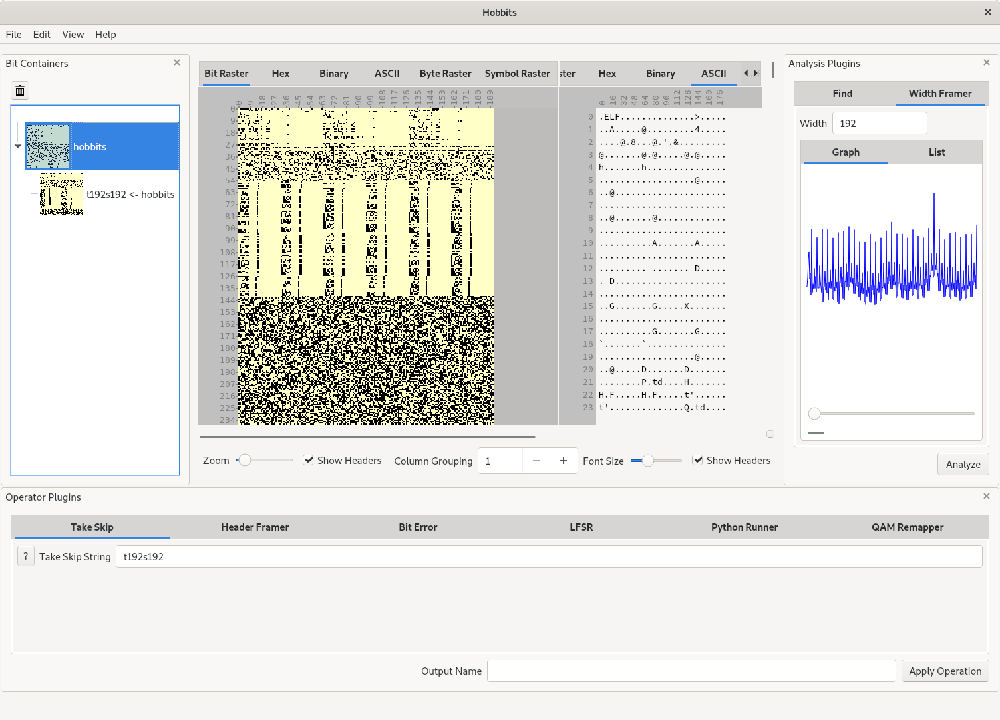

[](https://discord.gg/wRQJpZZ)
[](https://github.com/Mahlet-Inc/hobbits/actions/workflows/prod-build.yml)
[](https://github.com/Mahlet-Inc/hobbits/actions/workflows/dev-build.yml)


## About
Hobbits was developed at Mahlet in 2019 as an integrated data analysis tool. It was open-sourced
and is now (passively) maintained by [Adam](https://github.com/hello-adam) and anyone who wants
to contribute. Join the [Discord server](https://discord.gg/wRQJpZZ) if you want to ask questions,
contribute, or just chat about binary analysis tools.

## Documentation
The documentation is available at
[mahlet-inc.github.io](https://mahlet-inc.github.io).

## Pre-built binaries
There are pre-built binaries of the latest release on the
[GitHub releases page](https://github.com/Mahlet-Inc/hobbits/releases).

## Using Hobbits
Read the [user guide](https://mahlet-inc.github.io/user-guide/) in the
documentation and/or watch
[this walkthrough video](https://youtu.be/6ygkhze36qM)

## Building from source

The default CMake superbuild downloads pinned, SHA-256-checked releases of Qt
6.8.3 (including matching QtWayland on Linux), libpcap, libusb, OpenSSL (Linux),
and a pinned PocketFFT revision. No application libraries or Git submodules need
to be installed beforehand. The first build includes Qt and can take a while.
Dependencies stay inside the build directory.

You need CMake 3.24+, a C++17 compiler, Ninja (or another CMake generator), and
your platform SDK. Unix builds also need Make and Perl. Missing m4, Bison and
Flex are built automatically for libpcap. Windows builds should run in an MSVC
Developer Command Prompt; packet-capture and USB plugins remain Unix-only.

Linux desktop builds include Wayland by default and need its development headers,
protocol scanner, and keyboard headers from the OS. Installing the X11/XCB
headers also enables the X11 backend for desktops that use it. These packages
provide the native display SDK; Qt itself is built by the superbuild.
For Ubuntu 24.04, install both backends' SDKs with:

```sh
sudo apt-get install cmake ninja-build g++ make perl pkg-config patchelf \
  libwayland-dev wayland-protocols \
  libx11-dev libx11-xcb-dev libxcb1-dev libxcb-cursor-dev libxcb-glx0-dev \
  libxcb-icccm4-dev libxcb-image0-dev libxcb-keysyms1-dev libxcb-randr0-dev \
  libxcb-render-util0-dev libxcb-shape0-dev libxcb-shm0-dev libxcb-sync-dev \
  libxcb-xfixes0-dev libxcb-xinerama0-dev libxcb-xkb-dev libxcb-render0-dev \
  libxkbcommon-dev libxkbcommon-x11-dev
```

See also [Qt's platform requirements](https://doc.qt.io/qt-6/linux-requirements.html).
Configuration fails if the required desktop SDK is missing. Use
`-DHOBBITS_ENABLE_WAYLAND=OFF` for an X11-only build; its XCB SDK is then required.
`-DHOBBITS_HEADLESS=ON` is only for automated offscreen tests: it omits both
Wayland and X11 support, so that build cannot open a desktop window.

```sh
cmake -S . -B build -G Ninja -DCMAKE_BUILD_TYPE=Release
cmake --build build --parallel 2
ctest --test-dir build --output-on-failure
cmake --install build --prefix "$PWD/install"
```

If an existing build uses a headless Qt prefix, create a fresh desktop build
directory (for example, replace `build` with `build-desktop` above) after
installing the display SDK. Installing headers alone does not add platform
plugins to an existing Qt build. The superbuild uses the same version for QtBase
and QtWayland; do not mix Ubuntu's `qt6-wayland` plugins with the bundled Qt 6.8.3
runtime.

Build outputs are in `build/bin`, `build/lib`, and `build/plugins`. Run
`build/bin/hobbits` (on macOS, `build/bin/hobbits.app/Contents/MacOS/hobbits`).
Visual Studio, Xcode, and Ninja Multi-Config keep each configuration under
`build/<Config>/bin`, `build/<Config>/lib`, and `build/<Config>/plugins`; select it
with `cmake --build build --config Release` and `ctest --test-dir build -C Release`.
Build-tree and installed plugins are discovered automatically; `-p` can add an
extra plugin search directory. Installed paths are relative to the executable,
so moving the install directory or using `cmake --install --prefix` works.

Python is optional. If a regular Python 3.8+ interpreter and matching shared embedding
development library are found, the Python Runner and Kaitai Struct plugins are
built. On Debian/Ubuntu, install `python3-dev` to enable them. Otherwise these
plugins and the Python binding library are omitted. Use
`-DHOBBITS_ENABLE_PYTHON=OFF` to disable them explicitly, or
`-DPython3_ROOT_DIR=/path/to/python` to select an installation. Set
`-DHOBBITS_PYTHON_VERSION=3.14` to require that major/minor version instead of
automatically choosing any available Python.

CI produces standalone Windows ZIPs and Linux tarballs with Python 3.14, using
the latest patch available from `setup-python`. They include the matching shared
library, standard library, and native modules; Linux also bundles the native
modules' shared-library dependencies, except glibc and the OS loader. These
packages do not need Python installed. Linux standalone builds target Ubuntu
24.04 or a compatible newer system. The bundled interpreter ignores system
Python environment variables and user site-packages. Third-party Python packages
from the build machine are not included. `--python-home` can explicitly select
another compatible Python home.

The separate Ubuntu 24.04 `.deb` is built against `/usr/bin/python3.12` and depends
on Ubuntu's `python3.12` and `libpython3.12t64` packages. It does not bundle Python.
Install it with `sudo apt install ./hobbits_*.deb` so apt installs the dependencies.
The application and Qt libraries live under `/usr/lib/hobbits`, with `hobbits`
and `hobbits-runner` launchers in `/usr/bin` and a desktop menu entry.

For a local Debian package, install `python3.12-dev` and `dpkg-dev`, then configure
a separate build directory:

```sh
cmake -S . -B build-deb -G Ninja -DCMAKE_BUILD_TYPE=Release \
  -DCPACK_GENERATOR=DEB -DCMAKE_INSTALL_PREFIX=/usr \
  -DHOBBITS_BUNDLE_PYTHON=OFF -DHOBBITS_PYTHON_VERSION=3.12 \
  -DPython3_EXECUTABLE=/usr/bin/python3.12 -DPython3_ROOT_DIR=/usr
cmake --build build-deb --target package --parallel 2
```

Build-tree and non-bundled runs still require the matching Python runtime.
On macOS, Python's standard library is not bundled.

Useful build options:

- `-DHOBBITS_USE_SYSTEM_QT=ON`: use an installed Qt 6.8+; other dependencies are
  still built automatically. Set `CMAKE_PREFIX_PATH` for a nonstandard Qt path.
  On Linux, use a complete Qt installation with matching Wayland or XCB platform plugins.
- `-DHOBBITS_ENABLE_WAYLAND=OFF`: build only the X11 desktop backend on Linux.
- `-DHOBBITS_DEPENDENCY_JOBS=4`: parallel jobs for each dependency/application
  build. The outer `--parallel` controls how many dependency projects build at once.
- `-DHOBBITS_DOWNLOAD_DIR=/path/to/cache`: reuse source archives between builds.
- `-DSELF_CONTAINED_APP=OFF`: omit deployment of Qt; also defaults Python bundling to off.
- `-DHOBBITS_BUNDLE_PYTHON=OFF`: use an installed Python instead of bundling it,
  while retaining Qt deployment. Required for the Ubuntu `.deb` build.
- `-DHOBBITS_SUPERBUILD=OFF`: configure the application directly against existing
  dependencies, useful for packaging or IDE work. The normal superbuild's inner
  CMake project is `build/app`.

`cmake --build build --target package` creates a package from the inner project.
Hobbits remains MIT licensed; see [THIRD_PARTY_NOTICES.txt](THIRD_PARTY_NOTICES.txt)
for bundled dependency licenses. Dependency notices are included in installs.

## Adding plugins
Read the
[plugin developer guide](https://mahlet-inc.github.io/plugin-developer-guide/)
in the documentation.


